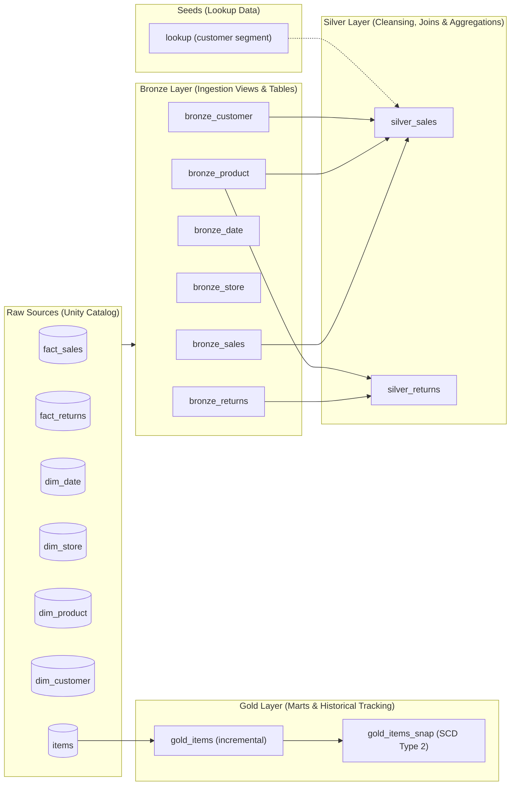

# Databricks dbt Data Pipeline

A modern, production-grade data transformation pipeline built with **dbt (data build tool)** and **Databricks**, implementing a complete **Medallion Architecture (Bronze → Silver → Gold)** alongside **SCD Type 2 Snapshots**, **Seeds**, **Analyses**, and **Multi-Environment deployment (Dev & Prod)**.

---

## 🏗️ Architecture Overview

The pipeline ingests raw sales, returns, customer, and catalog data into Databricks Unity Catalog and orchestrates it across medallion layers:



### Medallion Layer Breakdown

| Layer | Target Schema | Materialization | Description |
| :--- | :--- | :--- | :--- |
| **Seeds** | `bronze` | `table` | Static reference data (`lookup.csv` for customer segmentation) loaded directly into the warehouse. |
| **Bronze** | `bronze` | `view` / `table` | Direct 1:1 ingestion from source catalog (`{{ target.catalog }}.source.*`). Standardizes source schemas. `bronze_sales` & `bronze_returns` configured as tables. |
| **Silver** | `silver` | `table` | Conformed, cleansed, joined business models. Aggregates gross sales and returns by category and customer demographics. |
| **Gold** | `gold` | `incremental` | High-value analytical marts. Deduplicates incoming item records based on latest timestamps. |
| **Snapshots** | `gold` | `snapshot` | Type 2 Slowly Changing Dimension (SCD Type 2) tracking historical record changes over time. |

---

## 📁 Repository Structure

```text
dbt_course/
├── src/                               # Source raw CSV datasets (sales, returns, dimensions)
├── pyproject.toml                     # Python dependencies (managed via uv / pip)
├── .env.example                       # Environment variables template
├── README.md                          # Main project documentation
└── dbt_databricks/                    # dbt project root
    ├── dbt_project.yml                # Project configurations, materializations & schemas
    ├── profiles.yml                   # Databricks profiles (dev & prod targets)
    ├── seeds/
    │   └── lookup.csv                 # Customer segment lookup seed
    ├── models/
    │   ├── sources/
    │   │   └── sources.yml            # Dynamic Unity Catalog source definitions
    │   ├── bronze/                    # Bronze layer models & schema tests
    │   │   ├── bronze_customer.sql
    │   │   ├── bronze_date.sql
    │   │   ├── bronze_product.sql
    │   │   ├── bronze_returns.sql
    │   │   ├── bronze_sales.sql
    │   │   ├── bronze_store.sql
    │   │   └── properties.yml         # Model properties and data tests
    │   ├── silver/                    # Silver layer models (conformed & aggregated)
    │   │   ├── silver_sales.sql       # Joins sales, products & customers with calculated gross
    │   │   └── silver_returns.sql     # Aggregates return totals by product category
    │   └── gold/                      # Gold layer models
    │       └── gold_items.sql         # Deduplicated items mart (incremental)
    ├── snapshots/
    │   └── gold_items.yml             # SCD Type 2 snapshot for gold_items
    ├── macros/
    │   ├── generate_schema.sql        # Custom schema macro (clean schema names)
    │   └── multiply.sql               # Helper calculation macro
    ├── analyses/                      # Ad-hoc analyses & Jinja templating experiments
    │   ├── explore_first.sql          # Ad-hoc seed exploration
    │   ├── jinja_first.sql            # Jinja loops, column lists & conditional filters
    │   └── query_macro.sql            # Macro invocation demonstration
    └── tests/
        ├── generic/
        │   └── generic_non_negative.sql # Custom generic data quality test
        └── non_negativr_test.sql        # Singular data validation test
```

---

## 🌍 Multi-Environment Configuration (`dev` & `prod`)

The project supports multi-environment deployments configured in `profiles.yml`:

| Target | Catalog | Warehouse Schema | Use Case |
| :--- | :--- | :--- | :--- |
| **`dev`** *(default)* | `dbt_vault` | `default` | Local development and testing |
| **`prod`** | `dbt_vault_prod` | `default` | Production deployment |

`sources.yml` dynamically points to the active target catalog using `database: '{{ target.catalog }}'`, ensuring seamless promotion across environments without code changes.

---

## ⚙️ Tech Stack & Requirements

* **Python**: `>=3.13`
* **Package Manager**: [uv](https://github.com/astral-sh/uv) (or `pip` / `venv`)
* **dbt Core**: `1.12.5+`
* **dbt-databricks**: `1.12.6+`
* **Target Warehouse**: Databricks SQL Warehouse (Unity Catalog enabled)

---

## 🚀 Getting Started

### 1. Environment Setup

Clone the repository and install dependencies:

```bash
# Using uv (recommended)
uv sync

# Or using standard venv + pip
python3 -m venv .venv
source .venv/bin/activate
pip install dbt-core dbt-databricks
```

### 2. Configure Environment Variables

Copy `.env.example` to `.env` and set your Databricks Personal Access Token:

```bash
cp .env.example .env
```

Edit `.env`:
```env
DATABRICKS_TOKEN=your_personal_access_token_here
```

Export variables in your active shell:
```bash
export $(grep -v '^#' .env | xargs)
```

### 3. Verify Connection

Navigate into `dbt_databricks/` and test connection:

```bash
cd dbt_databricks
dbt debug
```

---

## 🏃 Commands & Workflow

### 1. Load Seeds
Upload seed reference tables (e.g., `lookup.csv`) into the `bronze` schema:
```bash
dbt seed
```

### 2. Run Models
```bash
# Run all models in dev
dbt run

# Run only a specific layer
dbt run --select bronze
dbt run --select silver
dbt run --select gold

# Run against production
dbt run --target prod
```

### 3. Run Snapshots (SCD Type 2)
Capture state changes and update snapshot validity timestamps:
```bash
dbt snapshot
```

### 4. Run Tests
```bash
# Run all data tests
dbt test

# Test a specific model or layer
dbt test --select bronze
dbt test --select silver
```

### 5. Compile Analyses & Inspect Queries
```bash
# Compile analysis SQL files without executing against warehouse
dbt compile --select analyses/
```

### 6. Documentation
```bash
dbt docs generate
dbt docs serve
```

---

## 🧪 Data Testing & Quality

* **Generic Schema Tests**:
  * `not_null` & `unique` constraints on keys (`sales_id`, `store_sk`).
  * `accepted_values` test on `store_name` with `severity: warn`.
* **Custom Generic Test** (`generic_non_negative`):
  * Reusable test macro in `tests/generic/generic_non_negative.sql` validating numeric columns (`gross_amount`, `net_amount`) are non-negative (`>= 0`).
* **Singular Tests**:
  * Custom SQL tests in `tests/` validating business logic constraints across dataset models.

---

## 🔧 Macros & Jinja Capabilities

* **`generate_schema_name`** ([macros/generate_schema.sql](dbt_databricks/macros/generate_schema.sql)):
  Overrides dbt's default behavior of prefixing schemas with the target name (e.g. `default_bronze`), producing clean schema names (`bronze`, `silver`, `gold`).
* **`multiply`** ([macros/multiply.sql](dbt_databricks/macros/multiply.sql)):
  Reusable calculation macro used in `silver_sales.sql` to compute `unit_price * quantity`.
* **Analyses & Dynamic SQL** ([analyses/jinja_first.sql](dbt_databricks/analyses/jinja_first.sql)):
  Demonstrates advanced Jinja features including dynamic column list looping, `loop.last` comma control, and conditional incremental filtering (``).

---

## 📸 Snapshots (SCD Type 2)

Historical tracking is configured in [snapshots/gold_items.yml](dbt_databricks/snapshots/gold_items.yml):
* **Target Model**: `ref('gold_items')`
* **Strategy**: `timestamp` on `updated_at: updateDate`
* **Unique Key**: `id`
* **Current Validity Sentinel**: `dbt_valid_to_current: "to_date('2099-01-01')"`
